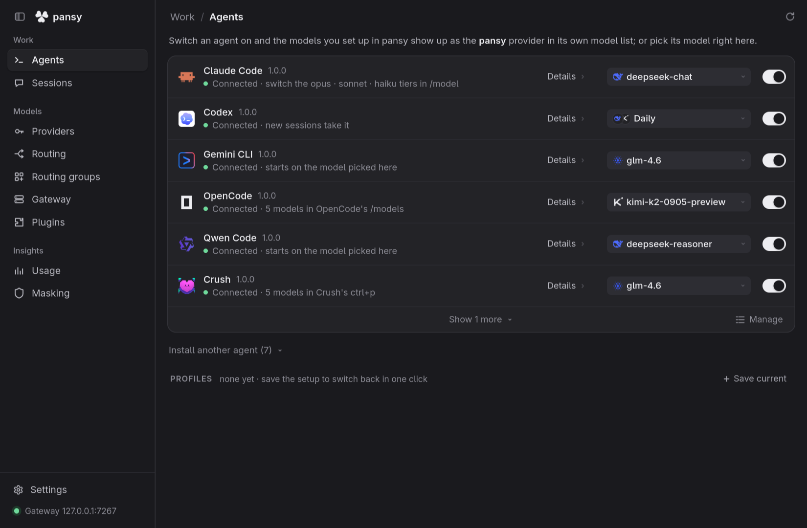

<div align="center">


# pansy

### Every agent's model. One place.

**Claude Code on Kimi. Codex on DeepSeek. Gemini CLI on GLM.**<br>
Pick any model for any agent; one local gateway serves them all,<br>
and when a key runs out of quota, the next one quietly takes over.

**English** · [简体中文](README.zh-CN.md)

</div>

pansy is a local gateway and a desktop app for Linux, macOS and Windows,
written in Rust, its window built on [Native Shell](https://nsh.dev) (NSH). As
the three petals of its logo meet at one point, your agents and your providers
meet in one gateway. Everything runs on your computer: your keys, prompts and
replies go only to the providers you chose.



## What it does

- **Any model, any agent.** Pick a model for Claude Code, Codex, Gemini CLI,
  OpenCode, Qwen Code, Crush or any of some fifty agents from one list. pansy
  edits the one setting that
  matters in the agent's own config; comments, order and formatting stay as
  they were, and *Disconnect* puts back exactly what pansy changed.
- **One gateway, four protocols.** `127.0.0.1:7267` speaks Anthropic Messages,
  OpenAI Chat Completions, OpenAI Responses and Gemini, and translates between
  them — streaming, tool calls, reasoning and Codex's free-form tools included.
  When an agent and a provider speak the same protocol the request passes
  through untouched.
- **Keys that fail over.** A provider can hold several keys, tried in order. A
  key that is rate-limited, out of quota or refused rests for a while and the
  next one answers, before the agent sees an error. A limit rests the key for
  the model that hit it, not for its others; a request one model turns away
  goes on to the next model of its group; a connection that broke is asked
  once more first.
- **Subscriptions.** A ChatGPT plan, as Codex uses it, GitHub Copilot's and
  Gemini Code Assist's, as Gemini CLI uses it, serve every agent: pansy reads
  the sign-in Codex, Copilot's editors and Gemini CLI already have, where they
  keep it, and signs in to more accounts itself (in the browser or by a
  code). Each is a provider (`codex/…`, `copilot/…`, `gemini-cli/…`) whose
  accounts fail over like keys; what each has left of its allowance is on
  the Usage page and in `pansy limits`, and one its vendor holds is passed
  over until its window renews.
- **Routing groups.** `group/daily` is several models picked as one, in order,
  taking turns or least used first; groups can contain groups.
- **Profiles.** Save every agent's model under one name and switch them all
  back in one move.
- **Sessions.** Claude Code's, Codex's and OpenCode's sessions on this
  computer, by the folder they ran in: what each spent, the command that
  resumes it, what was said in it, found by its words. Delete moves a
  session's files into pansy's trash, which puts them back (OpenCode's live in
  a database it keeps open, so they are only listed).
- **Usage.** Requests, tokens and cache reads by day, model, agent and
  provider, counted on this computer. Prompts and replies are never kept.
- **Masking.** API keys, tokens, passwords, personal data and your own words
  leave this computer as placeholders (`{{API_KEY_k3j9x2ab}}`) and come back as
  they were in the answer, streamed or not. Each kind can instead warn or hold
  the request back; Insights › Masking shows what each vendor saw, never
  keeping the values.
- **A model for one run, a model for one folder.** `pansy run claude` starts
  an agent on a model without writing its config, so two terminals use two
  models at once. A project's `.pansy.toml` names the model each agent uses
  there (model names alone, no keys; one that came with a repository counts
  only after you say yes to it), and Usage counts requests by project.
- **Shown before it is done.** *What it changes* on an agent's row, and
  `pansy <agent> <model> --show`, list every key connecting would set in the
  agent's files, with what is there now.
- **Tested between protocols.** [docs/compat.md](docs/compat.md) is written
  by a test from hand-written requests and answers in all four protocols,
  and fails the build when it stops being true. What a vendor's models
  refuse is data (`pansy quirks`, your own in `quirks.toml`).
- **Agents as files.** An agent is a TOML manifest
  ([docs/agents.md](docs/agents.md)); one of your own in
  `~/.config/pansy/agents/` needs no new pansy.
- **Brought over from what you have.** The providers CC Switch, Claude Code,
  Codex and OpenCode already hold are offered on the Providers page, read
  only, their keys masked; a `pansy://import?…` link, a pasted curl command
  or a vendor's environment lines fill a provider in.
- **60 presets.** Anthropic, OpenAI, Gemini, DeepSeek,
  xAI, Kimi and Kimi Code, Zhipu GLM, Z.ai, MiniMax, StepFun, Xiaomi MiMo,
  LongCat, Baidu Qianfan, Tencent Cloud, Huawei Cloud, Volcengine Ark, Qwen and
  Alibaba's Token Plans, Mistral, Groq, Amazon Bedrock, Azure OpenAI, Ollama
  Cloud, Nous Portal, OpenRouter, Vercel AI Gateway, OpenCode Go and Zen, Kilo,
  SiliconFlow, NVIDIA NIM, ModelScope, AiHubMix, Ollama, LM Studio, oMLX,
  GPUStack… each with its logo, its coding plans or regions picked in its
  editor, and any OpenAI-, Anthropic- or Gemini-compatible URL.

## Install

Download pansy for your system from
[releases.pansyai.dev](https://releases.pansyai.dev/index.html) or the
[GitHub releases](https://github.com/pansy-ai/pansy/releases):

- **macOS**: `pansy-<version>-macos-aarch64.dmg` (`x86_64` for Intel); drag
  Pansy to Applications. It is not notarized yet, so clear the quarantine
  first: `xattr -dr com.apple.quarantine /Applications/Pansy.app`.
- **Windows**: `pansy-<version>-windows-x86_64-setup.exe`, which installs
  for you alone, with no administrator, and can put `pansy` on PATH.
- **Linux**: `sudo apt install ./pansy-<version>-linux-x86_64.deb`, or the
  `.AppImage` (`chmod +x` and run it), or the archive:
  `tar -xzf pansy-<version>-linux-x86_64.tar.gz && ./pansy/install.sh`.

pansy then updates itself: Settings › About has the channel and What's new.

## Quick start

```sh
pansy provider add deepseek sk-…            # a preset needs only the key
pansy claude deepseek/deepseek-chat         # Claude Code on DeepSeek
pansy codex moonshot/kimi-k2-0905-preview   # Codex on Kimi
pansy group add "Daily" models=deepseek/deepseek-chat,moonshot/kimi-k2-0905-preview
pansy gemini group/daily                    # fails over between them
pansy claude opus anthropic/claude-opus-4-5 # Claude Code's opus tier; `pansy claude effort high`
pansy codex compact_at 200k                 # an agent's own settings; `default` puts one back
pansy opencode list hide moonshot/kimi-k2   # which models an agent lists; `pansy opencode names off`
pansy agents update all                     # the agents' own CLIs, to their newest
pansy save work && pansy use work           # profiles
pansy usage                                 # what went through the gateway
pansy settings set masking '{"secrets": true}'   # keys go to vendors as placeholders
pansy mask "my key is sk-proj-…"            # what a vendor would see
pansy serve                                 # the gateway without a window
pansy doctor                                # whether the gateway, providers and agents work
pansy test deepseek/deepseek-chat           # one short message through the gateway
pansy pause all && pansy resume all         # the agents on their own configs for now, and back
pansy project init                          # .pansy.toml: this folder's model for each agent
pansy run claude                            # Claude Code on it, for this run alone
pansy run --model group/daily codex         # or on another, in another terminal
pansy codex deepseek/deepseek-chat --show   # what connecting would write, and nothing written
```

Or open the window (`pansy` without arguments): **Providers → Add provider**,
then pick a model for each agent on **Agents**. Closing the window keeps pansy
in the tray, so the gateway goes on serving your agents.

Anything that takes a base URL can use the gateway too:

```sh
export OPENAI_BASE_URL=http://127.0.0.1:7267/v1     OPENAI_API_KEY=pansy
export ANTHROPIC_BASE_URL=http://127.0.0.1:7267     ANTHROPIC_API_KEY=pansy
export GOOGLE_GEMINI_BASE_URL=http://127.0.0.1:7267 GEMINI_API_KEY=pansy
```

## Building

```sh
# The core, the gateway and the headless `pansy` command
cargo test --workspace && cargo build --release -p pansy-cli

# The desktop app (NSH 0.6.1)
cd desktop
nsh check && ./test.sh                     # Rust and headless UI tests in a scratch home
cargo build -p pansy-desktop && nsh build App.tsx --out target/debug/nsh
./target/debug/pansy                       # the window, with the gateway beside it
packaging/build.sh                         # dist/pansy-<version>-<os>-<arch>.tar.gz (.zip on Windows)
packaging/installers.sh                    # and its installers: .dmg, -setup.exe, .deb and .AppImage
```

A release is a tag: the archives and installers of every system, and the
window's own updates, go to Cloudflare R2, where pansy looks for them, and
the installers to the tag's GitHub release too
([docs/release.md](docs/release.md)).

## Layout

| Path | What it is |
| :-- | :-- |
| `crates/pansy-core` | Providers, keys, models, presets, groups, settings, usage, masking's records, the subscriptions' sign-ins (`subscription/`); all files under `~/.config/pansy` (`PANSY_HOME`) |
| `crates/pansy-mask` | Masking: the rules that find secrets and personal data, placeholders, and putting the values back in streamed answers |
| `crates/pansy-gateway` | The gateway: the four protocols read into one shape and written back out (`ir.rs`, `proto/`), routing and failover (`route.rs`), what the Routing page plays (`trace.rs`), the HTTP side (`server.rs`) |
| `crates/pansy-agents` | The agents: finding them and their versions, editing their JSON/JSONC, TOML, `.env` and YAML configs in place, what was changed, profiles, their sessions (`sessions/`) |
| `crates/pansy-plugins` | Community plugins on Bun (OpenCode auth plugins, pi packages, middleware, agent plugins): installing them, the hosts they run in, sign-ins, middleware, agent plugins ([docs/plugins.md](docs/plugins.md)) |
| `crates/pansy-cli` | The `pansy` command |
| `desktop/` | The NSH app: `App.tsx` and `ui/` (TSX), `native/` (`pansy/native`, the Rust the TSX calls), `runner/` (the program) |
| `assets/brand` | The pansy logo: the app icon (SVG, PNG, ICO) and the one-color glyph |

## If you don't like something, fork it.

```sh
gh repo fork pansy-ai/pansy --clone && cd pansy/desktop
cargo build -p pansy-desktop && nsh build App.tsx --out target/debug/nsh
./target/debug/pansy                       # your window, with the gateway beside it
```

- **Change the UI.** The window is TSX: `desktop/App.tsx` and `desktop/ui/`,
  every string in `ui/i18n.ts`. Restyle every page to your taste.
- **Add an agent.** An agent is a manifest: a TOML in `~/.config/pansy/agents/`
  needs no build, and one in `crates/pansy-agents/agents/` is built in. A
  provider is a preset in `crates/pansy-core/src/presets.rs`. Wire in your
  own tools, models and flows.
- **Ship your own build.** `packaging/build.sh` makes the archives; put your
  own keys in `desktop/keys/` and your own feed in `nsh.json`'s `"updater"`
  ([docs/release.md](docs/release.md)), and distribute it as your own.

## License

[MIT](LICENSE). pansy began as a Rust rewrite of
[magpie](https://github.com/yetone/magpie) by yetone; see
[NOTICE.md](NOTICE.md) for it and the other work pansy builds on.
