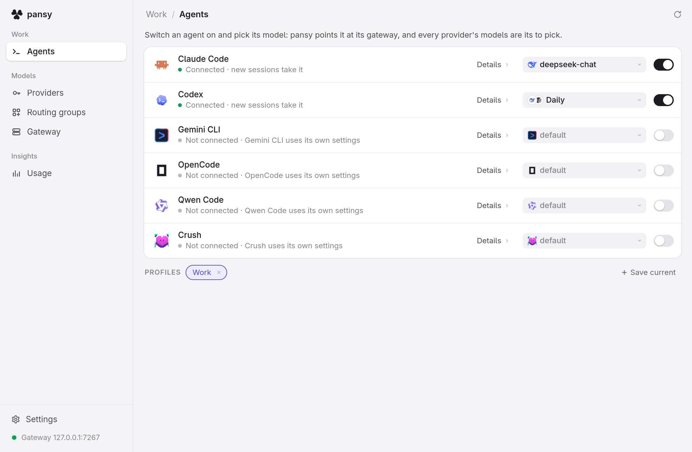

<div align="center">


# pansy

### 所有智能体的模型，集中在一处

**Claude Code 用 Kimi，Codex 用 DeepSeek，Gemini CLI 用 GLM。**<br>
为任意智能体选择任意模型；一个本地网关服务所有智能体，<br>
某个 Key 额度用尽时，下一个 Key 自动接替。

[English](README.md) · **简体中文**

</div>

pansy 是 [magpie](https://github.com/yetone/magpie) 的 Rust 重写版，桌面窗口基于
[Native Shell](https://nsh.dev)（NSH）0.5.1 构建。就像标志的三片花瓣汇聚于一点，
你的智能体和供应商也汇聚在同一个网关。

<picture>
  <source media="(prefers-color-scheme: dark)" srcset="assets/agents-dark.png">
  
</picture>

## 功能

- **任意智能体，任意模型。** 在一个列表里为 Claude Code、Codex、Gemini CLI、OpenCode、
  Qwen Code、Crush 选择模型。pansy 只修改智能体自身配置里关键的那几项，注释、顺序和格式保持原样；
  「断开」会精确还原 pansy 改过的内容。
- **一个网关，四种协议。** `127.0.0.1:7267` 同时支持 Anthropic Messages、OpenAI Chat Completions、
  OpenAI Responses 和 Gemini，并在它们之间互相转换（流式、工具调用、推理内容以及 Codex 的自由格式工具）。
  智能体与供应商使用同一协议时，请求原样透传。
- **Key 自动切换。** 一个供应商可以配置多个 Key，按顺序使用。被限流、额度用尽或被拒绝的 Key
  会暂停一段时间，由下一个 Key 接替，智能体看不到错误。
- **订阅。** ChatGPT 套餐（按 Codex 的方式使用）、GitHub Copilot 和 Gemini Code Assist（按 Gemini CLI
  的方式使用）供所有智能体使用：pansy 在 Codex、Copilot 编辑器插件和 Gemini CLI 保存登录的位置直接读取
  已有的登录，也能自己登录更多账号（在浏览器中或用验证码）。每个订阅是一个供应商（`codex/…`、
  `copilot/…`、`gemini-cli/…`），其中的账号像 Key 一样自动切换；每个账号剩余的额度显示在用量页和
  `pansy limits` 中，被厂商暂停的账号会跳过，直到额度重置。
- **路由组。** `group/daily` 把多个模型当作一个使用：按顺序、轮流或最少使用优先；路由组可以嵌套。
- **配置方案。** 把所有智能体的模型保存为一个方案，一键整体切换。
- **会话。** 这台电脑上 Claude Code、Codex 和 OpenCode 的会话，按运行时所在的文件夹归类：每个用了多少 Token、
  继续它的命令、对话内容，也能按说过的话查找。删除会把会话的文件移到 pansy 的回收站，随时可以恢复
  （OpenCode 的会话存在它一直打开的数据库里，所以只列出、不删除）。
- **用量统计。** 按天、模型、智能体、供应商统计请求数、Token 和缓存命中，全部在本机计算，
  不保存提示词和回复。
- **隐私脱敏。** API Key、令牌、密码、个人信息和你自己的词以占位符（`{{API_KEY_k3j9x2ab}}`）离开这台电脑，
  回复里（无论是否流式）再还原。每类值也可以设为只提醒或直接拦截请求；洞察 › 脱敏 页面显示每个厂商看到了什么，
  且从不保存原值。
- **一次运行用一个模型，一个文件夹用一个模型。** `pansy run claude` 启动智能体并指定模型，
  不写它的配置，两个终端可以同时用两个模型。项目里的 `.pansy.toml` 写明每个智能体在这里用哪个模型
  （只有模型名，没有密钥；随仓库带来的文件要你确认后才生效），用量可以按项目查看。
- **改之前先给看。** 智能体那一行的「会改什么」，以及 `pansy <agent> <model> --show`，
  会列出连接时要在智能体文件里设置的每个键，以及现在的值。
- **协议之间的转换有测试。** [docs/compat.md](docs/compat.md) 由测试生成：四种协议的请求和回复
  都是手写的样本，结论与代码不符时测试失败。各厂商模型拒绝的参数是数据（`pansy quirks`，
  自己的规则写在 `quirks.toml`）。
- **智能体是文件。** 一个智能体就是一份 TOML 清单（[docs/agents.md](docs/agents.md)）；
  放进 `~/.config/pansy/agents/` 的清单不需要新版 pansy。
- **60 个预设，与 magpie 一致。** Anthropic、OpenAI、Gemini、DeepSeek、xAI、Kimi 与 Kimi Code、智谱 GLM、
  Z.ai、MiniMax、阶跃星辰、小米 MiMo、LongCat、百度千帆、腾讯云、华为云、火山方舟、千问与阿里云的 Token Plan、
  Mistral、Groq、Amazon Bedrock、Azure OpenAI、Ollama Cloud、Nous Portal、OpenRouter、Vercel AI Gateway、
  OpenCode Go 与 Zen、Kilo、硅基流动、NVIDIA NIM、魔搭、AiHubMix、Ollama、LM Studio、oMLX、GPUStack……
  每个都用 magpie 的 logo，编码套餐或区域在编辑器里选择；以及任意兼容 OpenAI、Anthropic、Gemini 的地址。

## 快速开始

```sh
pansy provider add deepseek sk-…            # 预设只需要 Key
pansy claude deepseek/deepseek-chat         # Claude Code 使用 DeepSeek
pansy codex moonshot/kimi-k2-0905-preview   # Codex 使用 Kimi
pansy group add "Daily" models=deepseek/deepseek-chat,moonshot/kimi-k2-0905-preview
pansy gemini group/daily                    # 在两者之间自动切换
pansy save work && pansy use work           # 配置方案
pansy usage                                 # 经过网关的用量
pansy settings set masking '{"secrets": true}'   # Key 以占位符发给厂商
pansy mask "我的 Key 是 sk-proj-…"           # 看看厂商会收到什么
pansy serve                                 # 无窗口运行网关
pansy doctor                                # 检查网关、供应商和智能体是否正常
pansy test deepseek/deepseek-chat           # 经网关发一条简短的测试消息
pansy pause all && pansy resume all         # 智能体临时用回自己的配置，再接回来
pansy project init                          # .pansy.toml：这个文件夹里每个智能体用的模型
pansy run claude                            # 只在这一次运行里让 Claude Code 用它
pansy run --model group/daily codex         # 或者在另一个终端用另一个模型
pansy codex deepseek/deepseek-chat --show   # 连接会写入什么，但什么都不写
```

也可以打开窗口（不带参数运行 `pansy`）：**供应商 → 添加供应商**，然后在**智能体**页为每个智能体选择模型。
关闭窗口后 pansy 留在托盘里，网关继续为智能体服务。

任何可以设置 Base URL 的工具都能使用这个网关：

```sh
export OPENAI_BASE_URL=http://127.0.0.1:7267/v1     OPENAI_API_KEY=pansy
export ANTHROPIC_BASE_URL=http://127.0.0.1:7267     ANTHROPIC_API_KEY=pansy
export GOOGLE_GEMINI_BASE_URL=http://127.0.0.1:7267 GEMINI_API_KEY=pansy
```

## 构建

```sh
# 核心、网关和无窗口的 pansy 命令
cargo test --workspace && cargo build --release -p pansy-cli

# 桌面应用（NSH 0.5.1）
cd desktop
nsh check && ./test.sh                     # 在临时 HOME 中运行 Rust 测试和无头 UI 测试
cargo build -p pansy-desktop && nsh build App.tsx --out target/debug/nsh
./target/debug/pansy                       # 打开窗口，网关同时运行
packaging/build.sh                         # 生成 dist/pansy-<版本>-<系统>-<架构>.tar.gz（Windows 为 .zip）
```

发布由一个 tag 触发：各系统的安装包和窗口的热更新包上传到 Cloudflare R2，
pansy 从那里检查更新（[docs/release.md](docs/release.md)）。

## 目录

| 路径 | 内容 |
| :-- | :-- |
| `crates/pansy-core` | 供应商、Key、模型、预设、路由组、设置、用量、脱敏记录、订阅的登录（`subscription/`）；所有文件位于 `~/.config/pansy`（`PANSY_HOME`） |
| `crates/pansy-mask` | 脱敏：找出密钥和个人信息的规则、占位符，以及在流式回复中还原原值 |
| `crates/pansy-gateway` | 网关：四种协议读入统一结构再写出（`ir.rs`、`proto/`），路由与故障切换（`route.rs`），路由页播放的内容（`trace.rs`），HTTP 服务（`server.rs`） |
| `crates/pansy-agents` | 智能体：发现及其版本、原地编辑 JSON/JSONC、TOML、`.env`、YAML 配置、改动了什么、方案、会话（`sessions/`） |
| `crates/pansy-plugins` | 在 Bun 上运行 magpie 的社区插件：安装、运行它们的宿主进程、登录、中间件、智能体插件（[docs/plugins.md](docs/plugins.md)） |
| `crates/pansy-cli` | `pansy` 命令 |
| `desktop/` | NSH 应用：`App.tsx` 与 `ui/`（TSX），`native/`（`pansy/native`，TSX 调用的 Rust），`runner/`（可执行程序） |
| `assets/brand` | pansy 的标志：应用图标（SVG、PNG、ICO）和单色图形 |

## 重写进度

第一阶段移植了 magpie 的核心功能、基于规则的脱敏、ChatGPT、Copilot 和 Gemini Code Assist 订阅，以及 magpie 的社区插件（OpenCode 登录插件、pi 包、
中间件、智能体，见 [docs/plugins.md](docs/plugins.md)）。后续计划：Claude、Antigravity 和 Grok 的订阅以及额度、用本地模型脱敏、额度与费用、意图路由和 `smart`/`pace` 模式、资料库（指令、MCP 服务器、技能）、搜索与图像工具、
同步、远程 pansy 与按客户端区分的局域网 Key、TUI，以及 magpie 支持的其余 80 多个智能体。
详见 [docs/parity.md](docs/parity.md)。

## 许可

[MIT](LICENSE)。pansy 由 yetone 的 magpie 重写而来，见 [NOTICE.md](NOTICE.md)。
